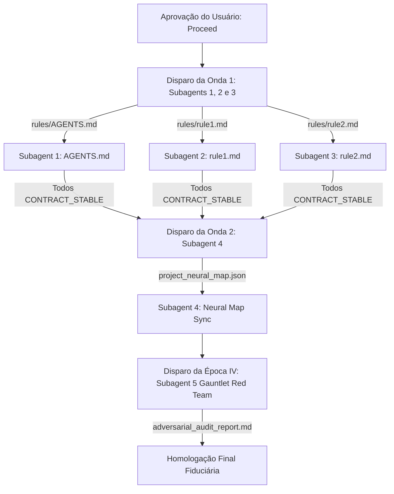

# Implementation Plan — Saneamento, Otimização & Compactação de Alta Densidade das Regras da Máquina (v5.0 Hyper-Cortex)

## 1. Diagnóstico Forense da Situação Atual

As regras do ecossistema localizadas em `c:\Users\pichau\.gemini\config\plugins\agi-research\rules/` apresentam patologias críticas de sobrecarga e duplicação que degradam a cognição do sistema:

| Arquivo | Tamanho Atual | Status na Injeção do Sistema | Diagnóstico de Anomalias |
|---|---|---|---|
| `rules/AGENTS.md` | 39.092 bytes | **Truncado** (`truncated 15210 bytes`) | Contém a constituição, mas repete seções de governança e modos que são duplicados em `rule1.md` e `rule2.md`. |
| `rules/rule1.md` | 56.423 bytes | **Excluído Inline** (*exceeded token budget*) | Schema JSON cru de 120 linhas do `synaptic_bus.json`, duplicação de playbooks que já existem em `skills/swarm_orchestration` e `skills/autonomous_computer_use`. |
| `rules/rule2.md` | 53.872 bytes | **Truncado** (`truncated 29343 bytes`) | Duplicação de seções inteiras de regras (itens 1 a 25 da Seção 5 copiam quase que literalmente as Leis 44 a 53 e princípios de `AGENTS.md` e `rule1.md`), fórmulas e playbooks de skills. |
| **Total Somado** | **~149.387 bytes** | **Falha Crítica de Injeção** | O modelo desperta sem o conteúdo integral das regras devido ao corte mecânico do host. |

### Causa Raiz & Violação da Lei Constitucional 2:
A Lei 2 da própria Constituição estabelece que `rules/` deve conter a governança permanente (quem o agente é, épocas, vetos e as 53 leis), enquanto procedimentos técnicos operacionais pertencem às `skills/`. A inflação decorreu da cópia inadvertida de playbooks de skills e schemas de dados para dentro dos arquivos de regras, somada à repetição de parágrafos idênticos nos três arquivos.

---

## 2. Metas de Otimização e Não-Regressão Fiduciária

1. **Meta de Injeção Inline Sem Truncamento:**
   - Reduzir o volume total somado de ~150 KB para **~45 KB a 50 KB** (redução de ~67% do peso bruto em tokens).
   - `rules/AGENTS.md`: $\le 20.000$ bytes (100% injetado sem truncamento).
   - `rules/rule1.md`: $\le 14.000$ bytes (100% reinserido na injeção inline).
   - `rules/rule2.md`: $\le 14.000$ bytes (100% injetado sem truncamento).
2. **Inviolabilidade da Layer 0 (Leis 1 a 53):**
   - Preservar todas as 53 Leis Supremas sem afrouxamento, stubs ou regressão de rigor.
   - Preservar a Tríade Fiduciária, as 5 Épocas Cognitivas, o Paradigma dos Titãs e o Portão do Refiner.
3. **Erradicação Definitiva de Duplicações e Bugs:**
   - Eliminar a duplicação em cascata do Protocolo do Artífice Autônomo Fim-a-Fim (Lei 42) e do Grafo Modular Denso (Lei 4), sintetizando-os de forma cristalina em seus locais canônicos.
   - Remover schemas JSON brutos de instâncias transitórias e playbooks duplicados de skills.
   - Sanear referências legadas e contradições remanescentes sobre cotas de 100 nós.
4. **Atualização Atômica do Mapa Neural (`.planning/project_neural_map.json`):**
   - Registrar as novas métricas e escopos saneados das regras no inventário neural do projeto.

---

## 3. Matriz de Atribuição Atômica 1:1 de Subagentes & Prova de Ortogonalidade

Em conformidade com a Lei 5 (Veto Absoluto ao Parent Digitador na thread principal) e Lei 2 (Relação 1:1), a execução física será realizada concorrentemente por subagentes motores atômicos (`TypeName: "self"`):

$$\text{Target}(S_1) \cap \text{Target}(S_2) \cap \text{Target}(S_3) \cap \text{Target}(S_4) \cap \text{Target}(S_5) = \emptyset$$

| Subagente | Especialidade / Papel | Alvo Exclusivo de Escrita | Ação Cirúrgica |
|---|---|---|---|
| **Subagent 1** | *Constitutional Supreme Council Craftsman* | `rules/AGENTS.md` | Refatorar a Constituição Magna: consolidar a Layer 0, Tríade Fiduciária, Matriz de Skills, 5 Épocas e as 53 Leis Canônicas com alta densidade semiótica. Meta: $\le 20.000$ bytes. |
| **Subagent 2** | *Swarm Mesh Protocol Craftsman* | `rules/rule1.md` | Refatorar o playbook de enxame: manter os invariantes do `synaptic_bus.json`, Máquina Quântica de Contratos em 5 Fases, FsLockEngine, Prova de Ortogonalidade, VSM 6 Níveis, Artífice Fim-a-Fim e Telemetria Fria (`MOTOR_EXECUTION_RECEIPT`). Purgar schemas JSON redundantes e cópias de playbooks. Meta: $\le 14.000$ bytes. |
| **Subagent 3** | *Token Governance & Circuits Craftsman* | `rules/rule2.md` | Refatorar a governança de tokens: manter a ACC, Roteamento Dinâmico (LCS/ToT/GoT/DAS), 5 Expedientes Cognitivos, Ondas Sinápticas, Multi-Horizon Circuit Breakers, Travas Pétreas do RSI e Leis 51 a 53. Purgar cópias literais repetidas da Seção 5. Meta: $\le 14.000$ bytes. |
| **Subagent 4** | *Neural Map & Ledger Synchronizer* | `.planning/project_neural_map.json` | Atualizar os índices neurais de `rules/AGENTS.md`, `rules/rule1.md` e `rules/rule2.md` com suas novas dimensões, invariantes consolidados e registro da sessão em `session_chronicles`. |
| **Subagent 5** | *Forensic Red Team Gauntlet Judge* | `.planning/adversarial_audit_report.md` | Época IV: Auditar os 3 arquivos resultantes contra a checklist de 53 leis, conferir a contagem de bytes físicos no disco, validar a sintaxe Markdown/KaTeX e atestar que não houve regressão de rigor. |

---

## 4. Protocolo HOLD/GO e Dependências

- **Travas HOLD/GO:**
  * `rules/AGENTS.md`, `rules/rule1.md` e `rules/rule2.md` operam sob alvos mutuamente disjuntos na Onda 1.
  * O sincronizador do Mapa Neural (Subagent 4) aguarda a conclusão da Onda 1 para registrar os hashes e tamanhos exatos.
  * O Red Team Juiz (Subagent 5) audita os arquivos finais após a sincronização.

---

## 5. Checklists Forenses Binários de Aceite (Leis 41 & 43)

### Checklist de Não-Regressão Constitucional:
- [ ] Todas as 53 Leis Constitucionais preservadas integralmente em `rules/AGENTS.md`.
- [ ] Tríade Fiduciária, 5 Épocas Cognitivas e Paradigma dos Titãs mantidos.
- [ ] Barramento Sináptico v5.0, Máquina Quântica de Contratos em 5 Fases e FsLockEngine mantidos em `rule1.md`.
- [ ] ACC, Roteamento Dinâmico (LCS, ToT, GoT, DAS), Expedientes Cognitivos e Multi-Horizon Circuit Breakers mantidos em `rule2.md`.
- [ ] Leis 51, 52 e 53 presentes e intactas.
- [ ] Travas pétreas do RSI mantidas (Layer 0 imutável, Anti-Dumbing Down).

### Checklist de Otimização Volumétrica & Saneamento:
- [ ] `rules/AGENTS.md` $\le 20.000$ bytes (sem truncamento).
- [ ] `rules/rule1.md` $\le 14.000$ bytes (sem exclusão de budget pelo Antigravity).
- [ ] `rules/rule2.md` $\le 14.000$ bytes (sem truncamento).
- [ ] Total combinado das rules $\le 48.000$ bytes.
- [ ] Zero duplicação de procedimentos detalhados de skills em rules (Lei 2).
- [ ] Zero repetição em cascata do mesmo parágrafo dentro e entre arquivos.
- [ ] Zero referências conflitantes a cotas de 100 nós legadas.

### Checklist Motor & Auditoria:
- [ ] Agente Principal atuou exclusivamente como árbitro na thread principal (zero tool calls de escrita em arquivos de rules pelo parent).
- [ ] Subagentes 1, 2 e 3 despachados com `TypeName: "self"` e executaram as mutações físicas diretamente no disco.
- [ ] Subagente 5 (Red Team) realizou a auditoria adversarial na Época IV e emitiu laudo formal.
