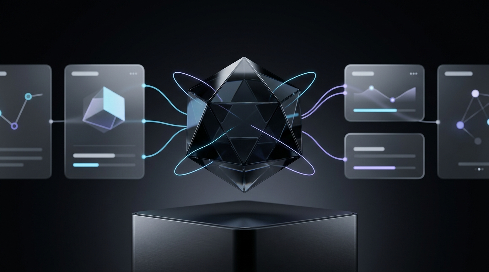
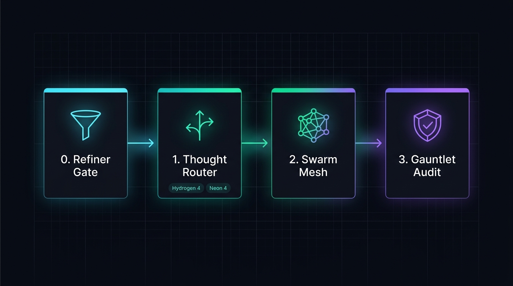
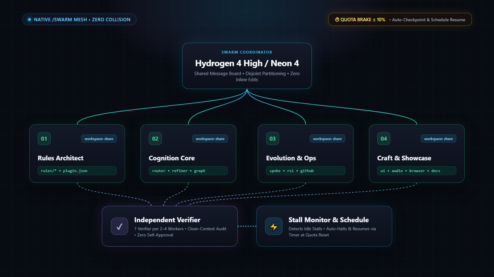
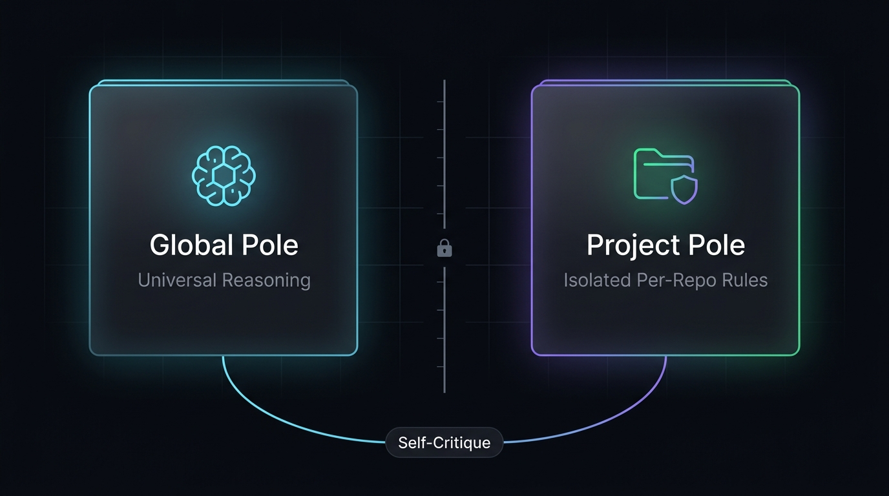

# Hyper-Cortex v6.0 (OmniCognition)

<div align="center">



**Turn Google Antigravity into a self-governing engineering swarm that reasons from first principles, ships zero-stub production code, protects your Gemini quota, tests itself in a real Chrome browser, and improves its own skills across projects.**

[](https://github.com/JokerQubit/AGI-Antigravity-skills-concept)
[](./plugin.json)
[](#-the-14-skill-cognitive-mesh)
[](#-smart-model-routing--the-10-quota-brake)
[](./rules/AGENTS.md)

[Why Hyper-Cortex](#-the-pain-with-naive-ai-coding) • [Architecture](#-how-hyper-cortex-v60-works) • [Swarm Mesh](#-native-swarm-orchestration) • [Model Routing & Quota Brake](#-smart-model-routing--the-10-quota-brake) • [Dual-Pole Evolution](#-dual-pole-self-improvement--project-neural-map) • [14 Skills](#-the-14-skill-cognitive-mesh) • [Quick Start](#-quick-start)

</div>

---

## ⚡ The Pain with Naive AI Coding

Most AI coding assistants look impressive on a 20-line toy prompt—and fall apart the moment you hand them a real codebase:

- **Blind Code Generation:** They edit files after reading half a snippet, breaking downstream contracts they never bothered to check.
- **Lazy Placeholders:** `// TODO: implement`, `return null`, silent `catch {}` blocks, and fake mocks disguised as finished work.
- **Swarm Chaos:** Parallel agents overwrite each other's files, burn context on status chatter, or mark their own buggy output as "verified."
- **Quota Lockouts Mid-Mission:** Long multi-agent runs slam into 0% model quota halfway through a refactor, leaving half-written files behind.
- **Project Amnesia & Rule Contamination:** Agents forget your repo's conventions every session—or worse, leak rules from a game mod into a web backend.
- **"Trust Me, It Works":** They claim victory without ever compiling, checking console errors, or rendering the UI in a real browser.

**Hyper-Cortex v6.0 (`agi-research`)** fixes every one of these failure modes at the root. Instead of hoping a single prompt behaves well, it gives Antigravity a lean **4-file Constitution (`rules/`)** and **14 auto-triggered playbooks (`skills/`)** that enforce first-principles reasoning, parallel swarm discipline, automatic quota protection, real-browser QA, and safe GitHub delivery.

---

## 🚀 Naive AI vs. Hyper-Cortex v6.0

| Naive AI Assistant | Hyper-Cortex v6.0 (`agi-research`) |
| :--- | :--- |
| ❌ Guesses after partial file reads | ✅ **Exhaustive Reads & Calibrated Uncertainty ($\varepsilon_t$)**: Halts writes if empirical uncertainty is too high (`ZONE_RED`) |
| ❌ One-size-fits-all shallow thinking | ✅ **Dynamic Thought Router**: Picks **LCS**, **ToT ($A^*$)**, **GoT**, or **Red Team DAS ($K \le 3$)** based on real problem physics |
| ❌ Single agent bottlenecks or colliding edits | ✅ **Native `/swarm` Mesh**: Disjoint file ownership, isolated `workspace:"share"` copies, and **1 independent `@verifier` per 2–4 workers** |
| ❌ Crashes into 0% API quota mid-refactor | ✅ **$\le 10\%$ Quota Brake + Auto-Resume**: Halts new waves at $\le 10\%$, saves a checkpoint to `.planning/ledger/`, and schedules resumption at `quota_resets` |
| ❌ Generic CSS, fake audio bleeps, zero QA | ✅ **Titan-Grade Craft**: 120Hz spring physics (`CLS = 0`), real CC0 acoustic Foley, and live Chrome audits via `browser-mcp` |
| ❌ Forgets architecture & risks messy pushes | ✅ **Project Neural Map + GitHub Sovereign Workflow**: Pre-flight backup snapshots, secret/binary scans, and clean `git add .` → `commit` → `push` |
| ❌ Repeats the same mistakes forever | ✅ **Dual-Pole Self-Evolution**: Improves global craft and per-repo `.agents/` rules independently without cross-project contamination |

---

## 🧠 How Hyper-Cortex v6.0 Works

Hyper-Cortex separates **permanent invariants** (`rules/`, always in context) from **deep step-by-step playbooks** (`skills/`, loaded on demand via a Skill Auto-Trigger Routing Table). Every non-trivial task flows through a clean, zero-bloat lifecycle:

<div align="center">



</div>

### Mode Bifurcation: Direct vs. Architectural
Hyper-Cortex never forces heavy ceremony onto a simple bugfix—and never lets a complex system start without contracts:

```text
[Your Request]
   │
   ▼
0. Refiner Gate (universal_prompt_refiner)
   ├── Reads .planning/project_neural_map.json (no project amnesia)
   ├── Computes Problem Signature Φ(P) & Epistemic Uncertainty ε_t
   ├── Auto-activates matching skills from the 14-skill mesh
   │
   ├──► DIRECT MODE (0 graph nodes on disk)
   │      • Single focused bugfix, local tweak, or repo onboarding
   │      • 100% budget goes to one End-to-End Artificer (reads 100%, edits, validates)
   │
   └──► ARCHITECTURAL MODE (Lean Modular Graph: 3–7 dense nodes, 5-node sweet spot)
          • Multi-subsystem features, refactors, or distributed concurrency
          • 1. Thought Router selects LCS / ToT (A*) / GoT / DAS (K ≤ 3)
          • 2. Contracts reach CONTRACT_STABLE before parallel coding begins
          • 3. Native /swarm workers build disjoint slices in parallel
          • 4. Independent @verifier / Red Team Judge audits disk + Chrome runtime
```

### Right-Sized Reasoning Topologies (Zero Academic Cosplay)
Instead of rambling or over-engineering simple edits, [`dynamic_thought_router`](./skills/dynamic_thought_router/SKILL.md) matches reasoning structure to the task:

| Topology | When It Activates | How It Works |
| :--- | :--- | :--- |
| **LCS** (*Linear Causal Stream*) | Builds, scripts, deterministic single-path fixes | Direct cause-and-effect ($X \to Y \to Z$) with zero wasted branching. |
| **ToT** (*Tree of Thoughts + $A^*$*) | Multi-hypothesis bugs, algorithm optimization | Explores 2–5 candidate branches and prunes weak paths ($f(n) < 0.75$) immediately. |
| **GoT** (*Graph of Thoughts*) | Coupled subsystems, concurrency, API meshes | Solves components concurrently and fuses interfaces before code is written. |
| **DAS** (*Dialectical Adversarial Synthesis*) | High-risk migrations, security, irreversible choices | Thesis vs. Red Team Antithesis → Synthesis, capped by a **hard tripwire at $K \le 3$** rounds so it never loops endlessly. |

---

## 🕸️ Native `/swarm` Orchestration

When work spans multiple files or specialties, Hyper-Cortex orchestrates **Antigravity Native `/swarm`** (and `invoke_subagent` for single-target tasks) with strict anti-collision engineering:

<div align="center">



</div>

- **Disjoint File Ownership:** No two workers ever own the same file ($\text{TargetFiles}(W_i) \cap \text{TargetFiles}(W_j) = \emptyset$).
- **Isolated Workspaces (`workspace:"share"` / `"branch"`):** Parallel editors get their own working copies so builds and edits never collide; readers and verifiers stay lightweight on `workspace:"inherit"`.
- **Lean Sizing & Warm Context (`fork`):** Typically **2–6 focused workers** (hard cap of 15/wave; partitioned into explicit channels if `> 8`). Workers start clean by default, or use `fork` when inheriting prior exploration saves costly re-reading.
- **Independent Verification Ratio:** Every **2–4 author workers** are paired with **1 independent `@verifier`** that audits real files, compiler exit codes, and browser telemetry—authors can never self-approve.
- **Zero-Noise Board Discipline:** `@mentions` act strictly as wakeup doorbells for the next peer (`author -> @verifier`). Workers sleep for free on `swarm_wait` instead of polling, and report `@coordinator [done] <summary>` only when finished or blocked.
- **Filesystem Concurrency Safety:** Shared critical writes use `FsLockEngine` (`O_CREAT | O_EXCL`) and `DeterministicAtomicSwap` (`.tmp` staging + `fsync` + dual SHA-256 verification).

---

## ⚡ Smart Model Routing & The ≤10% Quota Brake

Hyper-Cortex v6.0 routes intelligence automatically across three canonical Gemini tiers—**never asking you to manually toggle thinking levels**:

| Tier | Model ID | Assigned Role |
| :--- | :--- | :--- |
| **Standard Operational** | `gemini-4-hydrogen-high` (**Hydrogen 4 High**) | Regular coordination, Direct Mode tasks, standard `/swarm` workers, well-specified implementation. |
| **Strong & Fast** | `gemini-4-hydrogen-xhigh` (**Hydrogen 4 XHigh**) | High-speed parallel synthesis, heavy multi-file coding, dense refactors with clear contracts. |
| **Strong & Deep Reasoning** | `gemini-4-neon-high` (**Gemini 4 Neon High**) | Deep GoT/DAS architecture, `@verifier` / Red Team Gauntlet audits, complex root-cause debugging. |

### The ≤10% Quota Brake + Auto-Schedule Resumption
Before launching new waves or heavy operations, agents check `swarm{action:"models"}` and system `[quota]` alerts. If remaining Gemini quota hits **$\le 10\%$**:

1. **Immediate Halt:** No new `/swarm` waves, subagents, or heavy builds are spawned (only in-flight atomic file writes finish cleanly).
2. **Disk Checkpoint:** Full mission state (goal, completed files, active/pending workers, exact next step, and `quota_resets` timestamp) is saved to `.planning/ledger/quota_checkpoint_<timestamp>.json`.
3. **Automatic `schedule` Timer:** The agent schedules a one-shot wake-up via Antigravity's `schedule` tool right after `quota_resets` with a self-contained resumption prompt—so long builds pause gracefully and pick up right where they left off instead of locking your models.

---

## 🧬 Dual-Pole Self-Improvement & Project Neural Map

Hyper-Cortex v6.0 gets sharper every time you use it—without turning your global setup into a messy junk drawer of project-specific hacks.

<div align="center">



</div>

### 1. Strict Dual-Pole Isolation
- **Global Pole (`rules/`, `skills/`, `~/.gemini/`):** Evolves universal reasoning, orchestration, UI/audio craft, and cross-project recovery whenever `autonomous_rsi_engine` detects recurring friction or tool misuse. Protected by the **Anti-Dumbing Down Invariant** (changes can only maintain or raise rigor—never weaken Layer 0 safety).
- **Project Pole (`<repo_root>/.agents/rules/` & `.agents/skills/`):** When entering a new or unfamiliar repo, `spoke_rule_factory` inspects its manifests, lockfiles, compilers, and runtime budgets to generate local rules and project skills (tracked by `.agents/spoke_manifest.json`). Stack quirks (Rust, Next.js, C++, Lua, etc.) stay **100% quarantined** inside that repo.

### 2. Project Neural Map (Anti-Amnesia)
Every active repository maintains **`.planning/project_neural_map.json`** and **`.planning/PROJECT_NEURAL_MAP.md`**, tracking:
- Module topology & ownership boundaries
- Public API & type contracts
- Dependency graph & Architecture Decision Records (ADRs)
- Solved bugs & local anti-pattern registry

Agents read the Neural Map before editing and refresh it after structural changes—eliminating "context reset amnesia" across sessions.

---

## 🎨 Titan Craft, Real Browser QA & Safe GitHub Delivery

- **Titan-Grade Interfaces ([`modern_ui_craft`](./skills/modern_ui_craft/SKILL.md)):** Enforces 120Hz/ProMotion 2nd-order spring physics ($\zeta \in [0.72, 0.86]$), GPU-only `transform`/`opacity` animations, `CLS = 0.000`, `INP <= 16ms`, and optical 8-variable image generation prompts—zero generic placeholders.
- **Physical Acoustic Audio ([`tactile_audio_sfx`](./skills/tactile_audio_sfx/SKILL.md)):** Bans synthetic `OscillatorNode` bleeps; fetches and slices real CC0 acoustic Foley via [`scripts/sfx_tool.py`](./scripts/sfx_tool.py) with EBU R128 LUFS normalization (`-16` UI / `-14` critical), sub-5ms anti-click envelopes, and 3D HRTF `PannerNode` spatialization.
- **Real Chrome Verification ([`browser_visual_reasoning`](./skills/browser_visual_reasoning/SKILL.md)):** Uses `browser-mcp` (`@agent360/browser-mcp` in [`mcp_config.json`](./mcp_config.json)) to inject `perceptual_audit.js`, inspect multi-viewport rendering, measure frame drops, and require **zero console errors or 404s**.
- **GitHub Sovereign Workflow ([`github_sovereign_workflow`](./skills/github_sovereign_workflow/SKILL.md)):** Enforces **pre-flight backup commits** before risky refactors, rule/schema overhauls, destructive git ops, or parallel swarm waves—and finishes validated work with a secret/`.gitignore`/large-binary hygiene gate followed by `git add .` → Conventional `git commit` → upstream-verified `git push`.

---

## 🧰 The 14-Skill Cognitive Mesh

Hyper-Cortex v6.0 loads skills **autonomously** from the Skill Auto-Trigger Routing Table in [`rules/rule3.md`](./rules/rule3.md)—no magic slash commands required:

### Governance, Reasoning & Swarm (5 Skills)
| Skill | What It Owns |
| :--- | :--- |
| [`universal_prompt_refiner`](./skills/universal_prompt_refiner/SKILL.md) | Epoch 0 Ingestion Gate: 4-layer deconstruction, 8-axis $\Phi(P)$, 14-skill auto-activation, Direct vs. Architectural classification, `.planning/refiner_seal.json`. |
| [`adaptive_token_governance`](./skills/adaptive_token_governance/SKILL.md) | 7D cost-complexity assessment, Hydrogen/Neon model routing, Micro/Macro drawdown breakers, and the $\le 10\%$ Quota Brake + `schedule` resumption. |
| [`dynamic_thought_router`](./skills/dynamic_thought_router/SKILL.md) | Runtime selection between **LCS**, **ToT ($A^*$ pruning $f(n) \ge 0.75$)**, **GoT (multilinear fusion)**, and **DAS ($K \le 3$ tripwire)** persisted to `.planning/thought_graph.json`. |
| [`fractal_thought_graph`](./skills/fractal_thought_graph/SKILL.md) | Project Neural Map (`project_neural_map.json` + `PROJECT_NEURAL_MAP.md`), 3–7 node Lean Modular Graphs in `.planning/nodes/`, and dispatch matrices. |
| [`swarm_orchestration`](./skills/swarm_orchestration/SKILL.md) | Native `/swarm` & `invoke_subagent` orchestration, `synaptic_bus.json`, 5-phase contracts, SCDA, `FsLockEngine`, and End-to-End Artificers. |

### Engineering, Craft & Runtime QA (5 Skills)
| Skill | What It Owns |
| :--- | :--- |
| [`hardened_clean_architecture`](./skills/hardened_clean_architecture/SKILL.md) | Decoupled `core/use_cases/adapters`, `Result<T,E>` / `Option<T>`, `DeterministicAtomicSwap`, `FsLockEngine`, full-jitter polling, zero-stub production code. |
| [`modern_ui_craft`](./skills/modern_ui_craft/SKILL.md) | 120Hz 2nd-order spring kinematics, GPU compositor isolation, 8-variable `generate_image` photography, machined UI micro-renders, `CLS = 0` / `INP <= 16ms`. |
| [`tactile_audio_sfx`](./skills/tactile_audio_sfx/SKILL.md) | Real CC0 acoustic Foley via `scripts/sfx_tool.py`, EBU R128 LUFS normalization, SFM anti-fraud checks, 20Hz DC blocker, 3D HRTF `PannerNode`. |
| [`browser_visual_reasoning`](./skills/browser_visual_reasoning/SKILL.md) | Live Chrome verification via `browser-mcp`, `perceptual_audit.js` telemetry, multi-viewport checks, zero console errors / 404 assets. |
| [`forensic_adversarial_auditor`](./skills/forensic_adversarial_auditor/SKILL.md) | Independent Red Team Judge running the 5-pass Sovereign Gauntlet (G-0..G-4), CAFE premise fuzzing, physical disk/compiler proof, and `[HARD REJECT]` vetoes. |

### OS Ops, Repo Grounding, GitHub & Self-Evolution (4 Skills)
| Skill | What It Owns |
| :--- | :--- |
| [`autonomous_computer_use`](./skills/autonomous_computer_use/SKILL.md) | Closed-loop OODA shell execution and deterministic OS self-healing (port `EADDRINUSE`, zombie PIDs, Windows `EBUSY`/`EPERM` locks, corrupted caches, `.git/*.lock`). |
| [`spoke_rule_factory`](./skills/spoke_rule_factory/SKILL.md) | Onboarding unfamiliar repos, 7D signature extraction, compiling isolated `.agents/rules/`, `.agents/skills/`, and `.agents/spoke_manifest.json` + Neural Map sync. |
| [`autonomous_rsi_engine`](./skills/autonomous_rsi_engine/SKILL.md) | Post-mortem friction analysis and Dual-Pole skill/rule evolution with search-before-create deduplication and monotonic safety invariants. |
| [`github_sovereign_workflow`](./skills/github_sovereign_workflow/SKILL.md) | Pre-flight backup snapshots before risky/swarm work, secret/`.gitignore`/binary hygiene gates, Conventional Commits, safe `git push`, and branch recovery. |

---

## 📜 The 4-File Constitutional Core (`rules/`)

The `rules/` directory stays intentionally compact, high-signal, and completely non-duplicated against `skills/`:

| File | Responsibility |
| :--- | :--- |
| [`rules/AGENTS.md`](./rules/AGENTS.md) | **Core Constitution:** Fidelity Triad, first-principles causality (zero academic cosplay), SSOT split, Direct vs. Architectural lifecycle, Dual-Pole Autonomy, and Layer 0 invariants. |
| [`rules/rule1.md`](./rules/rule1.md) | **Swarm & Concurrency:** `/swarm` vs. `invoke_subagent`, lean sizing, disjoint files, `workspace:"share"`, `fork`, 1:2–4 verifier ratio, `>8` channels, 5-phase contracts, OODA & locks. |
| [`rules/rule2.md`](./rules/rule2.md) | **Reasoning, Models & Quota Brake:** Calibrated $\varepsilon_t$, Micro/Macro drawdown breakers, LCS/ToT/GoT/DAS, Hydrogen 4 High/XHigh & Gemini 4 Neon High routing, $\le 10\%$ Quota Brake + `schedule` resume. |
| [`rules/rule3.md`](./rules/rule3.md) | **Skill Mesh, Project Grounding & GitHub Backup:** 14-skill Auto-Trigger Routing Table, Project Neural Map & `.agents/` standards, and GitHub Sovereign Backup rules. |

---

## ⚙️ Quick Start

### Option 1: Install as a Google Antigravity Plugin (Recommended)

Clone directly into your Antigravity plugins directory:

**macOS / Linux:**
```bash
git clone https://github.com/JokerQubit/AGI-Antigravity-skills-concept.git ~/.gemini/config/plugins/agi-research
```

**Windows (PowerShell):**
```powershell
git clone https://github.com/JokerQubit/AGI-Antigravity-skills-concept.git "$env:USERPROFILE\.gemini\config\plugins\agi-research"
```

Open **Google Antigravity**. The plugin loads automatically via [`plugin.json`](./plugin.json) (including `browser-mcp` support configured in [`mcp_config.json`](./mcp_config.json)).

### Option 2: Try These First Prompts
Once installed, ask Antigravity naturally—skills and routing trigger automatically:
- *"Map this repository into a Project Neural Map and generate isolated `.agents/rules/` for our stack."*
- *"Refactor our auth & persistence layer with Clean Architecture, spin up a `/swarm` with an independent verifier, and back up before starting."*
- *"Build a 120Hz interactive dashboard with tactile SFX and verify zero console errors in Chrome."*

---

## ❓ FAQ

<details>
<summary><b>Will Hyper-Cortex slow down tiny bugfixes with heavy planning?</b></summary>
No. Tasks classified as <b>Direct Mode</b> create <b>0 graph nodes</b> on disk and go straight to a single End-to-End Artificer using Linear Causal Stream (LCS) on Hydrogen 4 High. Heavy multi-agent graphs only activate for genuine architectural work.
</details>

<details>
<summary><b>Does project-specific learning leak into my other repositories?</b></summary>
Never. Stack conventions, local frameworks, and repo quirks are written exclusively to <code>&lt;repo_root&gt;/.agents/rules/</code> and <code>.agents/skills/</code> (the <b>Project Pole</b>). The <b>Global Pole</b> only absorbs universal, cross-project engineering improvements.
</details>

<details>
<summary><b>What happens if my Gemini quota drops below 10% during a big <code>/swarm</code> run?</b></summary>
Hyper-Cortex triggers the <b>Quota Brake</b>: it immediately stops spawning new waves, saves a structured checkpoint in <code>.planning/ledger/</code>, reads <code>quota_resets</code>, and uses the <code>schedule</code> tool to automatically resume work after reset—preventing hard model lockouts and lost state.
</details>

<details>
<summary><b>Do I need to manually switch models or thinking modes?</b></summary>
No. Hyper-Cortex v6.0 routes tasks autonomously across <code>gemini-4-hydrogen-high</code>, <code>gemini-4-hydrogen-xhigh</code>, and <code>gemini-4-neon-high</code> via swarm and subagent configuration.
</details>

---

## 🤝 Contributing

Contributions are welcome! To add a skill improvement or bugfix:
1. Fork the repository and create a feature branch (`git checkout -b feat/your-improvement`).
2. Keep `rules/` concise (invariants & triggers only) and put detailed procedures in `skills/*/SKILL.md`.
3. Verify all links, images, and YAML frontmatter, then open a Pull Request.

<div align="center">
<sub>Built with Hyper-Cortex v6.0 for Google Antigravity • OmniCognition Labs</sub>
</div>
